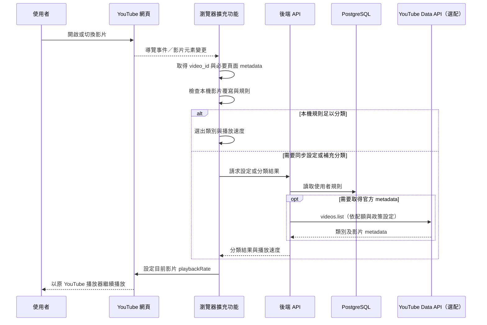

# YouTube 智慧播放速度控制器：系統設計與開發提案

## 一、產品定位與關鍵結論

建議把產品拆成「**桌面瀏覽器擴充功能**」與「**行動版設定／同步 App**」兩部分：

- **桌面 Web：以 Chrome／Edge 擴充功能為主要產品。** 在使用者原本的 `youtube.com` 播放器上調整播放速度，最有機會保留其登入狀態、觀看紀錄與推薦體驗。
- **行動 App：先做設定、同步與開啟 YouTube 的 companion app，不承諾能自動控制官方 YouTube App。** iOS／Android App 無法透過官方公開介面，可靠地控制另一個 App 內的 YouTube 播放器。
- **Google 登入不等於 YouTube 登入。** 產品用 Google 帳號登入是為了同步分類設定；使用者在 YouTube 的登入狀態則由 YouTube 自己維持。初版不需要索取 YouTube 帳號資料的 API 權限。
- **不能保證推薦演算法完全不變。** 擴充功能不讀取或寫入觀看紀錄，正常由 YouTube 播放影片；但任何觀看行為都可能影響 YouTube 自己的推薦系統，因此不應承諾推薦結果完全不受影響。

## 二、技術選型與架構規劃

### 2.1 Web 端：Browser Extension 為最佳起點

瀏覽器擴充功能可在 YouTube 原網站執行內容腳本，監聽播放器並調整影片播放速度；Chrome 官方說明內容腳本能讀取頁面 DOM，並與擴充功能其他部分通訊。[Chrome Extensions：Content scripts](https://developer.chrome.com/docs/extensions/develop/concepts/content-scripts)

| 平台 | 建議支援方式 | 說明 |
|---|---|---|
| Chrome 桌面版 | Manifest V3 擴充功能 | 首發平台，直接支援 `youtube.com` 播放頁 |
| Edge 桌面版 | Chromium 擴充功能 | 可沿用大部分 Chrome 程式碼與發布流程 |
| Safari macOS | Safari Web Extension | 以共用 WebExtension 程式碼為主，再做 Safari 封裝與測試 |
| Safari iOS／iPadOS | Safari Web Extension，列為後續支援 | 需使用者啟用擴充功能；行動版 YouTube 網頁行為需另外驗證 |
| Android 手機瀏覽器 | 不列為 MVP 自動控制目標 | 不假設一般手機版 Chrome 能載入桌面擴充功能；行動版以 companion app 為主 |

**擴充功能組成**

```text
┌───────────────────────────────┐
│ YouTube 網頁（原生網站與播放器）│
│  └─ Content Script             │
│     ├─ 偵測影片／SPA 頁面切換   │
│     ├─ 取得影片識別資訊         │
│     └─ 設定 video.playbackRate   │
└───────────────┬───────────────┘
                │ extension messaging
┌───────────────▼───────────────┐
│ Extension Service Worker       │
│  ├─ Google 登入狀態             │
│  ├─ 設定快取／同步              │
│  └─ 分類結果與規則決策           │
└───────────────┬───────────────┘
                │ HTTPS
┌───────────────▼───────────────┐
│ Backend API                    │
│  ├─ 使用者設定與速度規則         │
│  ├─ 分類服務（選配）             │
│  └─ YouTube Data API（選配）     │
└───────────────────────────────┘
```

速度設定的核心應直接作用在目前頁面的 HTML video 元素，而不是重製 YouTube 播放器。YouTube 使用單頁式導覽時，內容腳本必須處理影片切換、播放器重新建立及 DOM 變更；實作上可以監聽 YouTube 導覽事件並搭配有限範圍的 `MutationObserver`，避免對整個頁面持續高頻掃描。

### 2.2 登入與 YouTube 帳號的界線

Google 登入用於確認產品帳號並同步設定，不應假設它會登入 YouTube，也不應把產品登入 session 當成 YouTube session。

建議：

- 透過 Google Identity Services 或平台支援的 OAuth 流程登入。
- 只索取產品登入所需的基本識別資訊；除非後續功能確實需要，**不要要求 YouTube Data API 的使用者授權**。
- 後端以 Google 提供的穩定使用者識別值識別帳號，不儲存使用者 Google 密碼。
- 使用者在 `youtube.com` 上的 YouTube 登入與 cookie 維持原狀。
- 產品登出只清除產品登入狀態與同步憑證，不應登出 YouTube。

Google 文件也明確區分「身分驗證」與「授權存取 Google API」兩件事；登入本身不應被設計成額外索取 API 權限的理由。[Google Identity：Overview](https://developers.google.com/identity/oauth2/web/guides/overview)

### 2.3 行動 App：可行方案與取捨

| 方案 | 可否自動控制播放速度 | 是否能確保沿用官方 YouTube App 的歷史／推薦 | 建議 |
|---|---:|---:|---|
| Companion App + 開啟 YouTube App | 否 | 最接近使用者原本體驗，但不能替官方 App 設速 | **建議的行動 MVP** |
| App 內嵌 YouTube IFrame Player API | 可控制嵌入式播放器 | **不能保證**與官方 YouTube App 的歷史、個人化狀態完全一致 | 可作為明確標示的「App 內播放模式」，不作為等價替代 |
| WebView 載入 `youtube.com` 並注入程式碼 | 不穩定 | 不可靠 | 不建議 |
| Android AccessibilityService 操作 YouTube App | 可能在特定情境操作 | 不穩定且涉及高風險權限及政策要求 | 不建議 |

YouTube IFrame Player API 有播放器控制方法，可用來載入影片與調整播放器行為；但那是**嵌入式播放器**，不是控制官方 YouTube App。[YouTube IFrame Player API](https://developers.google.com/youtube/iframe_api_reference) 若採用嵌入式播放器，還需符合 YouTube 對播放器識別、Referer 與最小播放器尺寸等要求。[YouTube API：Required Minimum Functionality](https://developers.google.com/youtube/terms/required-minimum-functionality)

因此，若「沿用使用者原本的 YouTube 生態」是硬性要求，行動版應定位為：

1. 管理分類、速度規則及同步設定。
2. 顯示擴充功能安裝／設定狀態。
3. 提供貼上 YouTube 連結後開啟官方 YouTube App 的捷徑。
4. 清楚說明行動版不會在官方 YouTube App 自動套用分類速度。

如果產品決定提供 IFrame 內播放，應把它標為不同播放模式，讓使用者知道登入狀態、觀看紀錄與推薦呈現**可能與官方 YouTube App 不同**。

### 2.4 後端與資料庫

**建議技術選型**

- 後端：TypeScript + Node.js（Fastify 或 NestJS）
- 資料庫：PostgreSQL
- 快取：Redis，僅在流量與分類 API 快取需求明確時加入
- 部署：任一支援 HTTPS、密鑰管理、背景工作與 PostgreSQL 的雲端平台
- App／設定介面：React；行動端可用 React Native 或 Flutter，依團隊能力選擇

MVP 可先不引入獨立微服務與複雜訊息佇列，將登入、設定、規則管理、分類判斷包在單一 API 服務即可。

**Schema 範例（簡化版）**

```sql
CREATE TABLE users (
  id UUID PRIMARY KEY,
  google_subject TEXT UNIQUE NOT NULL,
  email TEXT,
  account_status TEXT NOT NULL DEFAULT 'active',
  created_at TIMESTAMPTZ NOT NULL DEFAULT now(),
  updated_at TIMESTAMPTZ NOT NULL DEFAULT now(),
  deleted_at TIMESTAMPTZ
);

CREATE TABLE video_categories (
  id UUID PRIMARY KEY,
  user_id UUID NOT NULL REFERENCES users(id),
  name TEXT NOT NULL,
  default_speed NUMERIC(3,2) NOT NULL
    CHECK (default_speed >= 0.25 AND default_speed <= 2.00),
  is_system BOOLEAN NOT NULL DEFAULT false,
  created_at TIMESTAMPTZ NOT NULL DEFAULT now(),
  UNIQUE (user_id, name)
);

CREATE TABLE category_rules (
  id UUID PRIMARY KEY,
  category_id UUID NOT NULL REFERENCES video_categories(id)
    ON DELETE CASCADE,
  rule_type TEXT NOT NULL,
  rule_value TEXT NOT NULL,
  priority INTEGER NOT NULL DEFAULT 100,
  enabled BOOLEAN NOT NULL DEFAULT true
);

CREATE TABLE video_overrides (
  user_id UUID NOT NULL REFERENCES users(id),
  video_id TEXT NOT NULL,
  category_id UUID REFERENCES video_categories(id),
  speed_override NUMERIC(3,2)
    CHECK (speed_override IS NULL
      OR (speed_override >= 0.25 AND speed_override <= 2.00)),
  updated_at TIMESTAMPTZ NOT NULL DEFAULT now(),
  PRIMARY KEY (user_id, video_id)
);
```

`rule_type` 可使用 `keyword`、`category_id`、`channel_id` 或 `manual` 等值。若要儲存 API 取得的分類資料，應另外制定有效期限與清除策略，避免把可變動的 YouTube API 資料長期當作永久資料保存。

## 三、影片類型判斷機制

### 3.1 判斷原則：先使用者規則，再做通用分類

YouTube Data API 的影片類別通常較粗略，未必能區分「球賽精華」與「球員訪談」，也未必能正確區分「科普影片」與其他教育影片。標題、簡介和標籤也可能含有模糊或誤導資訊。因此分類應提供**信心分數、可覆寫結果與明確 fallback**，而非宣稱能百分之百自動判斷。

建議的判斷優先順序：

1. **使用者影片手動覆寫**：最明確，優先使用。
2. **使用者頻道／關鍵字規則**：例如指定某頻道為「說故事」。
3. **已快取的明確分類結果**：在有效期限內使用。
4. **YouTube 類別 ID 與影片 metadata 規則**：可選擇查詢 YouTube Data API。
5. **輕量 NLP 分類**：只在結果信心不足時使用。
6. **預設速度**：分類低信心或服務不可用時，採用使用者設定的預設速度，並讓使用者可快速修正。

### 3.2 成本效益實作流程

```text
取得 video_id
    │
    ├─ 有使用者手動覆寫？ ── 是 → 套用覆寫速度
    │
    ├─ 符合使用者頻道／關鍵字規則？ ── 是 → 套用類別速度
    │
    ├─ 有有效快取結果？ ── 是 → 套用快取類別速度
    │
    └─ 取得影片 metadata
          ├─ 類別 ID、標題／標籤規則
          ├─ 高信心 → 套用速度並短期快取
          ├─ 低信心 → 選配 NLP 分類
          └─ 仍低信心 → 使用預設速度並提示使用者
```

**逐步落地建議**

- **MVP：純本地規則。** 先支援系統預設類別、使用者關鍵字／頻道規則與影片手動覆寫；不用呼叫 API，延遲低、成本與隱私風險也最低。
- **第二階段：使用 YouTube Data API。** 以影片 ID 取得必要 metadata，例如影片類別、標題與標籤；不使用 `search.list` 來搜尋影片，因為產品已從目前播放頁取得影片 ID。
- **第三階段：選配 NLP。** 將分類限制在低信心情境，輸入最少必要文字，不上傳觀看紀錄或影片內容。回傳固定格式，例如 `{category, confidence}`。
- **低信心 fallback：** 維持使用者預設速度，不自行猜測並套用大幅不同的速度；使用者可在擴充功能彈出視窗立即更改分類或速度。
- **回饋改善：** 記錄使用者選擇的手動修正（僅限產品資料與清楚告知的範圍），用於改善個人規則，不把它等同於 YouTube 觀看紀錄。

YouTube Data API 有每日配額限制，且不同方法的成本不同；官方目前文件列出一般 API 預設每日配額與各方法成本，產品上線前應以 Cloud Console 的專案配額及現行文件重新核對。[YouTube Data API：Quota costs](https://developers.google.com/youtube/v3/determine_quota_cost)

**推薦的規則優先級**

```text
影片手動覆寫
  > 頻道規則
  > 使用者自訂關鍵字規則
  > Data API metadata 分類
  > NLP 分類
  > 使用者預設速度
```

## 四、核心運作流程

### 4.1 使用者流程

1. 使用者安裝擴充功能，首次啟動時看見功能範圍及資料用途說明。
2. 使用者以 Google 帳號登入產品，以便同步分類設定；Google 登入不改變 YouTube 登入狀態。
3. 使用者檢視預設分類及速度，可新增分類、調整速度、設定關鍵字或頻道規則。
4. 使用者打開 YouTube 並照常登入、瀏覽及播放影片。
5. 擴充功能偵測目前影片，套用手動覆寫或分類規則所指定的速度。
6. 若無法可靠分類，維持預設速度，並顯示目前分類及一鍵修正入口。
7. 設定變更後，本機立即生效；登入時再同步到後端。

### 4.2 系統流程



擴充功能在本機已有足夠規則時應能離線套用速度，避免網路延遲造成先播放一段時間後才改速。若需要呼叫後端或 Data API，應使用短逾時並回退至使用者預設速度。

## 五、技術挑戰與風險評估

| 風險 | 影響 | 建議緩解方式 |
|---|---|---|
| YouTube DOM／播放器實作變動 | 播放器偵測或 SPA 導覽事件可能失效 | 將播放器偵測封裝成小模組；以實際瀏覽器整合測試覆蓋一般影片、直播、播放清單與導覽切換；提供「暫停擴充功能」及錯誤回報 |
| 影片分類不準 | 使用者得到不合適的速度 | 手動覆寫優先；低信心時使用預設速度；提供快速更改類別和速度的 UI |
| YouTube Data API 配額／政策變更 | metadata 查詢可能受限或增加成本 | MVP 不依賴 API 才能播放；避免 `search.list`；減少重複查詢並依政策管理快取；定期檢查配額與政策文件 |
| OAuth 權限過多 | 降低使用者信任並增加審查負擔 | 登入只索取必要身分資訊；把登入與 API 授權分開；不儲存密碼或不必要的長期憑證 |
| 推薦結果無法完全保證不變 | 使用者可能把推薦變動歸因於產品 | 清楚承諾「不讀寫觀看紀錄、使用原 YouTube 播放器」，但不承諾推薦演算法結果完全不變；讓使用者可關閉自動調速 |
| IFrame 與官方 YouTube App 體驗不等價 | 行動版登入、歷史或推薦可能與原生 App 不同 | 行動 MVP 以 companion app 為主；嵌入式播放作為明確分開的選配模式 |
| Android AccessibilityService 政策與審查風險 | 可能要求額外揭露、同意及用途審核 | 不以 AccessibilityService 控制 YouTube；Google Play 對其使用有用途、揭露及申報要求。[Google Play：AccessibilityService policy](https://support.google.com/googleplay/android-developer/answer/10964491) |
| 瀏覽器商店審查／權限過寬 | 發布受阻或使用者不願安裝 | 僅要求 YouTube 網域所需權限；不用遠端程式碼更新核心邏輯；提供隱私說明、資料刪除與清楚的權限用途 |
| 分類資料的隱私及保留期限 | 使用者可能不希望影片 metadata 離開裝置 | 優先本機分類；如需後端 NLP，只傳必要的標題／描述文字且先告知；提供選擇退出與刪除機制 |

## 六、建議開發分期

### Phase 1：桌面 MVP

- Chrome／Edge Manifest V3 擴充功能。
- 原生 YouTube 頁面調速。
- 預設類別、分類規則、手動影片覆寫與自訂速度。
- Google 登入與雲端同步。
- 低信心分類使用預設速度，不依賴 AI 或 Data API 才能運作。

### Phase 2：分類強化與 Safari

- 選擇性接入 YouTube Data API metadata。
- 加入低信心 NLP 分類，搭配明確的資料使用告知。
- Safari Web Extension 相容性測試及發布。
- 加入分類準確率與自動調速成功率指標。

### Phase 3：行動 App

- 提供分類／速度設定管理、登入與同步。
- 連結至官方 YouTube App。
- 若市場驗證確有需求，再評估提供 App 內 IFrame 播放模式；不得把它宣稱為官方 YouTube App 的完整替代。

**成功指標建議：** 自動調速成功率、影片分類修正率、錯誤速度覆寫率、擴充功能停用率、規則同步失敗率。使用者應能在不登入產品帳號的情況下使用基本本機功能；若商業需求堅持必須登入，登入應只作為產品同步門檻，而不是宣稱是 YouTube 本身的登入。

## 官方參考

- [Chrome Extensions：Content scripts](https://developer.chrome.com/docs/extensions/develop/concepts/content-scripts)
- [Google Identity：Overview](https://developers.google.com/identity/oauth2/web/guides/overview)
- [YouTube IFrame Player API](https://developers.google.com/youtube/iframe_api_reference)
- [YouTube API：Required Minimum Functionality](https://developers.google.com/youtube/terms/required-minimum-functionality)
- [YouTube Data API：Quota costs](https://developers.google.com/youtube/v3/determine_quota_cost)
- [Google Play：AccessibilityService API 政策](https://support.google.com/googleplay/android-developer/answer/10964491)
- [Apple：App Review Guidelines](https://developer.apple.com/app-store/review/guidelines/)
